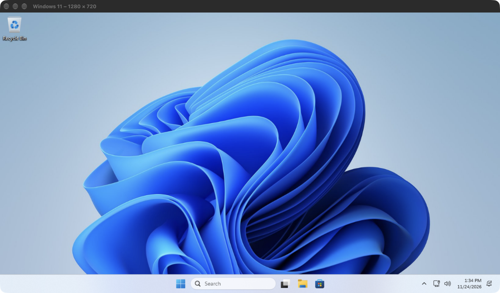
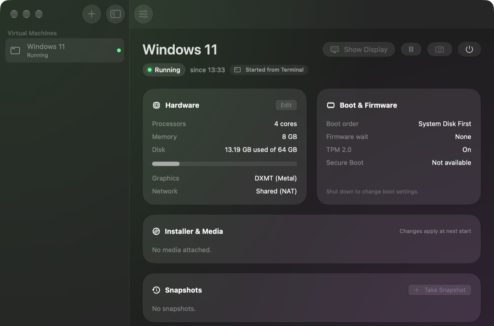

# Seemless
A parallel computing environment.

Seemless runs a minimal Windows 11 ARM virtual machine on Apple silicon Macs
and presents each Windows application window as a native Mac window, with
GPU-accelerated DirectX for games.



The app that manages your VMs:



**Status: working towards Preview 1**, the first public preview. There is no
release to download yet; you can build it from source (below). Current state:
[docs/STATUS.md](docs/STATUS.md). Plan: [docs/09-roadmap.md](docs/09-roadmap.md)
("Preview 1").

## What works today

- **A Mac app to manage VMs** (SwiftUI, macOS 26+): create a VM from your own
  Windows 11 ARM64 ISO with no Terminal, then start, pause, restart, shut
  down, open snapshots and change settings.
- **Unattended Windows install:** the image is built on your Mac from your
  ISO, trimmed, with the 3D graphics driver installed. You accept
  Microsoft's licence yourself at first start.
- **Desktop mode:** the whole Windows desktop in a Mac window, with
  keyboard, pointer, resize (the guest resolution follows), full screen,
  HiDPI and sound.
- **Direct3D 11** on Metal through UTM's Neptune/Triton stack and DXMT.
- **Experimental:** Direct3D 12 through vkd3d-proton on MoltenVK (simple
  programs only, older DXBC shaders only), and **Zen mode**: Windows app
  windows as borderless Mac windows. Zen runs against a test agent until the
  Windows guest agent lands.

## How it works

- **Runtime:** QEMU with Hypervisor.framework, one fixed configuration, based
  on UTM's QEMU fork.
- **Windows image:** built on your Mac from your own Microsoft ARM64 ISO,
  trimmed following the Tiny11 removal set, with drivers and a guest agent
  pre-installed. No Windows components are redistributed.
- **Graphics:** Direct3D calls are forwarded from a real WDDM driver in the
  guest to the host (UTM's Neptune/Triton stack). Direct3D 11 runs on DXMT;
  Direct3D 12 runs through vkd3d-proton on MoltenVK.
- **Zen mode:** a guest agent tracks every Windows window. The Mac app shows
  each one as its own window, with clipboard, files, notifications and Dock
  integration to follow.

## Requirements

- An Apple silicon Mac with macOS 26 or later.
- Your own Windows 11 ARM64 ISO
  ([from Microsoft](https://www.microsoft.com/software-download/windows11arm64))
  and a Windows licence.
- To build from source: Xcode 26 or later, plus the tools that
  `scripts/bootstrap.sh` checks for.

**First launch of a preview build:** Preview 1 is signed with a self-signed
certificate and is not notarized by Apple, so macOS blocks it the first
time. Open Seemless once, click **Done**, then go to **System Settings ▸
Privacy & Security** and click **Open Anyway** next to the Seemless message
(Control-click ▸ Open no longer works for this on macOS 15 and later).
Details: [Release packaging](docs/release.md#first-launch-for-testers-self-signed-builds).

## Building from source

```bash
scripts/bootstrap.sh               # check the tools
scripts/build-deps.sh fetch        # fetch the pinned sources
scripts/build-deps.sh all          # build QEMU and the graphics stack into build/prefix
scripts/build-app.sh --open        # build and open build/app/Seemless.app
```

`scripts/check.sh` runs every test that doesn't need a VM. Release packaging
(a self-contained, signed app) is described in [docs/release.md](docs/release.md).
More commands are in [CLAUDE.md](CLAUDE.md).

## Documentation

| Doc | Contents |
|-----|----------|
| [00 Overview](docs/00-overview.md) | Vision, goals, performance targets, non-goals, glossary |
| [01 Architecture](docs/01-architecture.md) | Components, processes, repo layout, decision log |
| [02 VM runtime](docs/02-vm-runtime.md) | QEMU build, command line, storage, lifecycle, patches |
| [03 Windows image](docs/03-windows-image.md) | Tiny11-style image pipeline, recipes, unattended install |
| [04 Graphics](docs/04-graphics.md) | Neptune/Triton stack, display export, driver signing |
| [05 Zen mode](docs/05-seamless-mode.md) | Per-window capture, geometry, input, focus |
| [06 Guest agent and protocol](docs/06-guest-agent-protocol.md) | Agent processes, message catalogue, validation |
| [07 Host app and integration](docs/07-host-app-integration.md) | App structure, keyboard, clipboard, files, audio, devices |
| [08 Performance and gaming](docs/08-performance-gaming.md) | Benchmarks, tuning, game mode |
| [09 Roadmap](docs/09-roadmap.md) | Milestones, Preview 1, spikes, work packages |
| [10 Risks and licensing](docs/10-risks-licensing.md) | Risk register, open questions, licence constraints |
| [11 References](docs/11-references.md) | Sources and what was verified |
| [Release packaging](docs/release.md) | Bundle layout, signing, notarization, source offers |
| [CI plan](docs/ci-plan.md) | PR, nightly, beta and release builds |

## Limits to know up front

- Apple silicon Macs running macOS 26 or later; Windows 11 ARM64 only.
- x64 games run through Windows' own emulator, so CPU-heavy titles run below
  native speed.
- Games that need kernel anti-cheat will not work.
- You need your own Windows ISO and licence.
- Suspending a VM isn't supported yet (shut it down instead).

## Contributing

Contributions are welcome: see [CONTRIBUTING.md](CONTRIBUTING.md) and our
[Code of Conduct](CODE_OF_CONDUCT.md).

## Licence

Seemless's own code is under the [MIT licence](LICENSE). The upstream
projects it builds on keep their own licences (QEMU is GPL-2.0, for example);
see [THIRD_PARTY.md](THIRD_PARTY.md). No Windows ISOs, images or other
Microsoft components are distributed.
